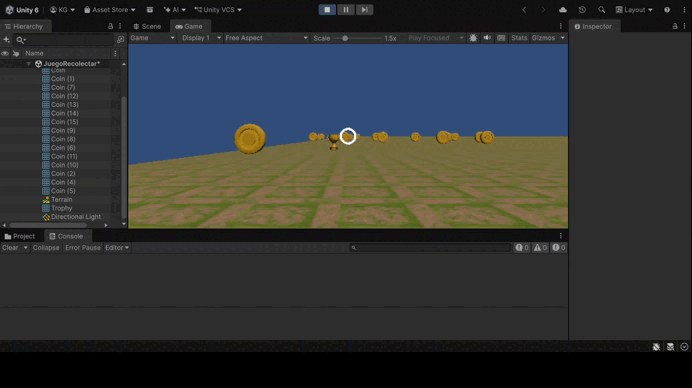

# Práctica de Unity: Realidad virtual con Google Cardboard

En esta práctica se crea una aplicación de realidad virtual para Android con el **Google Cardboard XR Plugin**. Primero se configura y compila la escena de ejemplo *HelloCardboard*. Después se construye una escena propia con terreno y objetos de la Asset Store, en la que el jugador se desplaza con la vista o con un mando y recolecta objetos mirándolos. Por último, un objeto recuperador hace que los recolectables vuelen hacia el jugador mediante un sistema de eventos.

📦 APKs: [hellocardboard.apk](APK/hellocardboard.apk) · [EscenaRecolectar.apk](APK/EscenaRecolectar.apk)



---

## Ejercicio 1: Proyecto Cardboard y APK de ejemplo

Se importa el paquete **Google Cardboard XR Plugin for Unity** y su ejemplo *Hello Cardboard*. Se configura la escena (capa *Interactive* para el objeto *Treasure* y en la máscara del retículo), la plataforma Android (orientación horizontal, IL2CPP, ARM64, *Target API Level* 35), los archivos Gradle personalizados con las dependencias de AndroidX y el proveedor **Cardboard XR Plugin** en *XR Plug-in Management*.

Para poder compilar se corrige el error `Please initialize Cardboard XR loader before calling this function` en `CardboardStartup.cs`, añadiendo una directiva de compilación para que la llamada solo se ejecute en el dispositivo y no en el editor:

```csharp
#if !UNITY_EDITOR   // Modificación
    Api.UpdateScreenParams();
#endif              // Modificación
```

📦 APK: [hellocardboard.apk](APK/hellocardboard.apk)

---

## Ejercicio 2: Escena con terreno y recolección con la vista

La escena incluye un **terreno** modelado con las herramientas de Unity y objetos de la **Asset Store** (escudos *3D Low Poly Shields* y humanoides *Mini Legion*). Los escudos son recolectables: están en la capa *Interactive* y tienen collider, de modo que el retículo de Cardboard les envía los mensajes `OnPointerEnter`, `OnPointerExit` y `OnPointerClick`.

- **Recolección con la vista:** un objeto se recoge cuando el jugador está a menos de 3 m y lo mira durante 1 segundo, o pulsa el botón del visor mientras lo mira. Al recogerlo se ocultan su malla y su collider, y se actualiza el contador.
- **Desplazamiento:** el jugador camina hacia donde mira al inclinar la vista hacia el suelo, o con el joystick izquierdo de un mando Bluetooth. En el editor se usa WASD. La altura se ajusta al terreno con `Terrain.SampleHeight`.

📄 Scripts: [Recolectable.cs](Scripts/Recolectable.cs) · [MovimientoJugador.cs](Scripts/MovimientoJugador.cs)

---

## Ejercicio 3: Objeto recuperador

Un objeto de la escena actúa como **recuperador**. Cuando el jugador lo mira durante 1,5 segundos (o pulsa el botón del visor mientras lo mira), se resalta y envía el evento `OnRecuperar`. Todos los recolectables están suscritos a ese evento y, al recibirlo, los que aún no se han recogido vuelan hacia el jugador con `Vector3.MoveTowards` y se recogen al llegar.

📄 Scripts: [Recuperador.cs](Scripts/Recuperador.cs) · [Recolectable.cs](Scripts/Recolectable.cs)

📦 APK: [EscenaRecolectar.apk](APK/EscenaRecolectar.apk)
